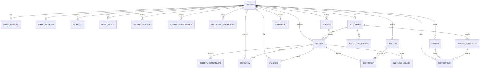

# 02 — Modelo de dados

- **Status:** Rascunho para aprovação
- **Schema de referência:** [`sql/001_schema.sql`](sql/001_schema.sql)
- **Funções:** [`sql/003_funcoes.sql`](sql/003_funcoes.sql)

## 1. Princípios do modelo

- **Uma conta por CPF:** o CPF é guardado como HMAC para unicidade e como valor cifrado para leitura autorizada.
- **Sem exclusão física:** contas, solicitações, reservas e mensagens usam status; a anonimização substitui dados pessoais quando a lei exigir.
- **Histórico é dado:** toda mudança de status e toda sanção geram registro de auditoria.
- **Reserva é transacional:** o banco garante que um horário não tenha duas reservas, mesmo com requisições simultâneas.
- **Minimização:** o catálogo lê views com dados parciais; dados completos só são liberados após a reserva.
- **Texto puro:** chat, descrições e comentários são `text`, sem HTML ([ADR 0003](../../adr/0003-conteudo-em-texto-puro.md)).
- **Tempo com fuso:** todo instante é `timestamptz`; datas de calendário são `date`; horários de agenda são `time` no fuso de Brasília.
- **Chaves:** `uuid` para entidades expostas; `bigserial` para logs e tabelas de alto volume.

O schema `elovital` tem **30 tabelas do EloVital**, sendo **26 de domínio** e **4 operacionais** (`tentativa_login`, `audit_log`, `acesso_dado_pessoal`, `expurgo_log`). As tabelas internas do Django (`auth_*`, `django_session`, `django_admin_log`, `django_migrations` e equivalentes) também ficam no schema, mas não entram nessa contagem nem neste catálogo.

## 2. Diagrama de entidades

## 3. Catálogo de tabelas

### 3.1 Contas e perfis

| Tabela | Função | Campos principais |
|---|---|---|
| `usuario` | Conta única, autenticação e papel | `email`, `password`, `nome_completo`, `cpf_hash`, `cpf_cifrado`, `data_nascimento`, `celular_cifrado`, `papel`, `status`, `is_staff` |
| `endereco` | Endereço do usuário e ponto de distância | `cep`, `logradouro`, `numero`, `bairro`, `municipio`, `uf`, `localizacao` |
| `termo_aceite` | Termos, consentimento de saúde e código de conduta | `tipo`, `versao`, `aceito_em`, `revogado_em`, `ip_hash` |
| `perfil_assistido` | Dados específicos do Assistido | `contato_emergencia_nome`, `contato_emergencia_telefone_cifrado`, `autorizacao_familiar_*` |
| `perfil_apoiador` | Dados específicos do Apoiador | `modalidade`, `raio_km`, `formacao` |
| `documento_verificacao` | Documento, selfie e registro profissional | `tipo`, `storage_path`, `hash_sha256`, `status`, `expurgo_em` |
| `tentativa_login` | Bloqueio temporário por tentativas falhas | `email_hash`, `ip_hash`, `sucesso`, `criado_em` |

### 3.2 Catálogos-base

| Tabela | Função |
|---|---|
| `condicao_cronica` | Lista editável de condições crônicas |
| `usuario_condicao` | Condições declaradas pelo Assistido |
| `especialidade` | Tipos de apoio e especialidades, com indicador de regulamentação |
| `usuario_especialidade` | Especialidades do Apoiador e registro profissional |
| `parametro` | Limites, prazos, raios e regras configuráveis pela mediação |

### 3.3 Agenda e solicitações

| Tabela | Função | Campos principais |
|---|---|---|
| `recorrencia` | Regra de repetição da agenda | `dias_semana`, `data_inicio`, `data_fim` |
| `horario` | Horário publicado pelo Apoiador | `data`, `hora_inicio`, `hora_fim`, `especialidade_id`, `modalidade`, `status`, `versao` |
| `solicitacao` | Necessidade criada pelo Assistido | `tipo_apoio_id`, `titulo`, `descricao`, `prioridade_sugerida`, `prioridade_final`, `status`, `expira_em` |
| `solicitacao_periodo` | Dias e períodos possíveis | `data`, `periodo` |
| `analise_solicitacao` | Parecer do mediador | `parecer`, `prioridade`, `justificativa`, `observacoes_internas` |
| `reserva` | Vínculo entre solicitação e horário | `solicitacao_id`, `horario_id`, `assistido_id`, `apoiador_id`, `status` |
| `reserva_confirmacao` | Dupla confirmação da realização | `parte`, `confirmado_em` |

### 3.4 Comunicação e reputação

| Tabela | Função |
|---|---|
| `mensagem` | Chat entre as partes de uma reserva |
| `bloqueio_usuario` | Bloqueio entre usuários |
| `avaliacao` | Nota, comentário e critérios por atendimento |
| `notificacao` | Central interna, e-mail e push |
| `ocorrencia` | Desistência, ausência, discordância e falhas |
| `denuncia` | Denúncia de perfil, solicitação, reserva ou mensagem |
| `sancao` | Advertência, suspensão ou bloqueio |
| `contestacao` | Contestação de sanção ou recusa |

### 3.5 Auditoria e operação

| Tabela | Função | Imutável |
|---|---|---|
| `audit_log` | Ação, ator, entidade, antes/depois, data e hora | Sim |
| `acesso_dado_pessoal` | Acesso da mediação a dado pessoal, com motivo | Sim |
| `expurgo_log` | Registro de anonimização e descarte | Sim |

## 4. Regras e constraints críticas

### 4.1 Unicidade e identidade

- `usuario.email` único (comparação sem diferenciar maiúsculas, via `citext`).
- `usuario.cpf_hash` único.
- `endereco`: no máximo um endereço principal por usuário.
- `termo_aceite`: um aceite por usuário, tipo e versão.
- `usuario_especialidade`: uma linha por usuário e especialidade.
- `avaliacao`: uma avaliação por reserva e autor.
- `reserva`: no máximo uma reserva ativa por solicitação.
- `reserva`: no máximo uma reserva não cancelada por horário.

### 4.2 Idade e CPF

- O cadastro exige `data_nascimento <= current_date - interval '18 years'`; a validação principal fica no service, com `CHECK` de apoio.
- O CPF não é armazenado em texto puro. `cpf_hash` é HMAC-SHA-256 com pepper; `cpf_cifrado` usa AES-256-GCM no application side.
- O CPF é imutável: o service não expõe operação de alteração e o banco não tem `UPDATE` de `cpf_hash`/`cpf_cifrado` para o papel da aplicação.
- A anonimização zera `cpf_hash`, `cpf_cifrado`, telefone, endereço e documentos, mantendo o identificador da conta e a auditoria.

### 4.3 Agenda e reserva

- `horario.hora_fim > horario.hora_inicio`.
- Duração entre 30 minutos e 4 horas.
- Horário não pode ser publicado no passado; a regra é validada no service por depender da data corrente.
- `horario.status = 'reservado'` quando existe reserva ativa; `realizado` após a conclusão; `liberado` quando volta à lista; `bloqueado` quando a mediação precisa decidir.
- A reserva usa `SELECT ... FOR UPDATE` no horário e na solicitação dentro de uma função transacional.
- O índice parcial `unique (horario_id) where status <> 'cancelada'` é a última barreira contra dupla reserva.
- A solicitação só pode ser reservada se estiver `aberta` e pertencer ao Assistido que está reservando.
- A reserva só é criada se o horário estiver `disponivel` e pertencer a um Apoiador ativo e verificado.

### 4.4 Conclusão e avaliação

- A conclusão exige duas linhas em `reserva_confirmacao`, uma por parte, dentro do prazo configurado.
- A avaliação só é permitida após a conclusão e dentro de 7 dias.
- A avaliação é imutável após o envio; a mediação pode ocultar o comentário, não alterar a nota.
- Nota entre 1 e 5; comentário até 300 caracteres.

### 4.5 Moderação e auditoria

- Toda sanção exige `motivo` e `mediador_id`.
- Toda análise de solicitação exige `mediador_id` e `parecer`.
- `audit_log`, `acesso_dado_pessoal` e `expurgo_log` são somente inserção; `UPDATE` e `DELETE` são bloqueados por trigger e por privilégio, exceto a zeragem de IP após 6 meses.
- O acesso da mediação a CPF, endereço, documento ou condição de saúde gera linha em `acesso_dado_pessoal`.
- Nenhum `DELETE` físico é permitido nas tabelas de domínio; o expurgo é `UPDATE` de anonimização.

## 5. Índices e desempenho

| Índice | Motivo |
|---|---|
| `usuario(email)` | Login e unicidade |
| `usuario(cpf_hash)` | Unicidade e busca de cadastro |
| `usuario(papel, status)` | Filas da mediação e contagens |
| `horario(status, data, hora_inicio)` | Catálogo por disponibilidade |
| `horario(apoiador_id, data)` | Agenda do Apoiador |
| `solicitacao(status, expira_em)` | Expiração e fila de análise |
| `solicitacao(assistido_id, criado_em desc)` | “Minhas solicitações” |
| `reserva(apoiador_id, status)` | Agenda e histórico do Apoiador |
| `reserva(assistido_id, status)` | Histórico do Assistido |
| `mensagem(reserva_id, enviada_em)` | Chat cronológico |
| `notificacao(usuario_id, lida_em)` | Central de notificações |
| `endereco using gist(localizacao)` | Filtro por raio com PostGIS |
| `usuario using gin(nome_completo gin_trgm_ops)` | Busca por nome na mediação |
| `solicitacao using gin(titulo gin_trgm_ops)` | Busca textual na mediação |
| `audit_log(criado_em)` | Consulta por período |

Regras:

- Paginação sempre com `LIMIT` e ordenação indexada.
- O catálogo usa `ST_DWithin` sobre `geography`, não cálculo em Python.
- Consultas da mediação usam views com colunas mascaradas.
- Evitar `SELECT *` em tabelas com colunas cifradas.
- Revisar planos com `EXPLAIN (ANALYZE, BUFFERS)` antes do piloto.

## 6. Funções e rotinas

| Função | Responsabilidade | Arquivo |
|---|---|---|
| `elovital.reservar_horario` | Cria a reserva de forma atômica, bloqueia horário e solicitação, atualiza status | `003_funcoes.sql` |
| `elovital.cancelar_reserva` | Cancela, libera ou bloqueia o horário conforme antecedência | `003_funcoes.sql` |
| `elovital.confirmar_conclusao` | Registra a confirmação de cada parte e conclui quando as duas confirmam | `003_funcoes.sql` |
| `elovital.expirar_solicitacoes` | Marca solicitações vencidas e bloqueia reservas sem dupla confirmação no prazo | `003_funcoes.sql` |
| `elovital.anonimizar_usuario` | Substitui dados pessoais e encerra a conta, sem excluir a linha | `003_funcoes.sql` |
| `elovital.documentos_a_expurgar` | Lista arquivos vencidos para remoção do Storage | `003_funcoes.sql` |
| `elovital.confirmar_expurgo_documento` | Marca o documento como expurgado após a remoção do arquivo | `003_funcoes.sql` |
| `elovital.expurgar_dados_vencidos` | Expurga notificações, tentativas de login e conteúdo de chat fora do prazo | `003_funcoes.sql` |
| `elovital.registrar_acesso_dado_pessoal` | Registra o acesso da mediação, com motivo obrigatório | `003_funcoes.sql` |
| `elovital.buscar_usuario_login` | Leitura mínima para login antes de existir contexto de RLS | `003_funcoes.sql` |
| `elovital.set_atualizado_em` | Atualiza `atualizado_em` em toda escrita | `003_funcoes.sql` |
| `elovital.auditar_alteracao` | Registra antes/depois em `audit_log`, com campos sensíveis mascarados | `003_funcoes.sql` |
| `elovital.proteger_auditoria` | Bloqueia `UPDATE` e `DELETE` em tabelas imutáveis | `002_seguranca.sql` |
| `elovital.proteger_cpf` | Bloqueia alteração de CPF fora da anonimização | `002_seguranca.sql` |

As rotinas de expiração, lembrete e expurgo são agendadas com `pg_cron` e registram o resultado em `expurgo_log` ou em log operacional.

## 7. Rastreabilidade requisito → tabelas

| Requisito | Tabelas principais |
|---|---|
| RF001 Cadastro | `usuario`, `endereco`, `termo_aceite`, `perfil_assistido`, `perfil_apoiador`, `usuario_condicao`, `usuario_especialidade`, `documento_verificacao` |
| RF002 Autenticação | `usuario`, `tentativa_login` |
| RF003 Perfil e privacidade | `usuario`, `endereco`, `termo_aceite`, `perfil_assistido`, `perfil_apoiador`, `usuario_especialidade` |
| RF004 Agenda | `horario`, `recorrencia`, `endereco`, `usuario_especialidade` |
| RF005 Solicitação | `solicitacao`, `solicitacao_periodo`, `endereco` |
| RF006 Análise | `analise_solicitacao`, `solicitacao`, `audit_log` |
| RF007 Catálogo | `horario`, `usuario`, `usuario_especialidade`, `avaliacao`, `endereco` |
| RF008 Reserva | `reserva`, `horario`, `solicitacao`, `reserva_confirmacao` |
| RF009 Cancelamento | `reserva`, `horario`, `ocorrencia`, `audit_log` |
| RF010 Notificações | `notificacao` |
| RF011 Chat | `mensagem`, `bloqueio_usuario`, `reserva` |
| RF012 Conclusão | `reserva_confirmacao`, `reserva` |
| RF013 Avaliação | `avaliacao`, `reserva` |
| RF014 Denúncia | `denuncia`, `sancao`, `audit_log` |
| RF015 Mediação | `parametro`, `sancao`, `contestacao`, `acesso_dado_pessoal`, `audit_log` |
| RF016 Verificação | `documento_verificacao`, `usuario_especialidade`, `usuario` |
| RF017 Histórico | `solicitacao`, `reserva`, `ocorrencia`, `notificacao` |

## 8. Dados sensíveis no modelo

| Dado | Onde fica | Proteção |
|---|---|---|
| CPF | `usuario.cpf_hash`, `usuario.cpf_cifrado` | HMAC + cifra; nunca em log |
| Telefone | `usuario.celular_cifrado` | Cifra; exibição apenas para o próprio usuário e mediação autorizada |
| Contato de emergência | `perfil_assistido.contato_emergencia_telefone_cifrado` | Cifra |
| Endereço exato | `endereco` | Acesso por service; catálogo usa bairro/município e distância |
| Condição crônica | `usuario_condicao` | Acesso restrito; não aparece no catálogo |
| Documentos | `documento_verificacao.storage_path` | Bucket privado, URL assinada, expurgo |
| Mensagens | `mensagem.texto` | Acesso pelas partes e mediação; sem log de conteúdo |
| Avaliações | `avaliacao.comentario` | Público no perfil, com moderação |

Os prazos de retenção e as bases legais estão na [Segurança e LGPD](03-seguranca-lgpd.md).

## 9. O que não vai no banco

- Senhas em texto puro ou hash reversível.
- Chaves de criptografia, pepper ou `service_role`.
- Conteúdo de documentos no próprio banco; apenas o caminho no Storage.
- Logs de aplicação com CPF, telefone, endereço, saúde ou conteúdo de chat.
- Dados de cartão, pagamento ou conta bancária, porque a plataforma não intermedeia valores.
- Tokens de sessão em texto puro fora da tabela de sessão do Django.

## 10. Checklist do modelo

- [ ] Schema `elovital` e tipos criados.
- [ ] 30 tabelas revisadas: 26 de domínio e 4 operacionais (`tentativa_login`, `audit_log`, `acesso_dado_pessoal`, `expurgo_log`).
- [ ] Constraints de CPF, idade, reserva e avaliação validadas.
- [ ] Índices de catálogo, histórico e distância criados.
- [ ] Função de reserva testada com duas sessões concorrentes.
- [ ] Função de cancelamento com 24 h e menos de 24 h testada.
- [ ] Rotina de expiração e expurgo agendada.
- [ ] Auditoria imutável testada.
- [ ] Views mascaradas para a mediação revisadas.
- [ ] Nenhuma coluna sensível exposta em `SELECT *`.
