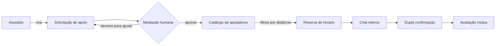

<div align="center">

# EloVital

**Rede de apoio solidária para pessoas com doenças crônicas**

Aproxima quem precisa de companhia e cuidado de quem tem tempo e conhecimento para oferecer — sempre com mediação humana.

[](#status-do-projeto)
[](#stack-e-arquitetura)
[](#stack-e-arquitetura)
[](#stack-e-arquitetura)
[](#privacidade-e-conformidade)

[Visão geral](#visão-geral) · [Como funciona](#como-funciona) · [Requisitos](#requisitos) · [Stack](#stack-e-arquitetura) · [Documentação](#documentação) · [Banco de dados](#banco-de-dados)

</div>

---

## Visão geral

O **EloVital** é uma plataforma web gratuita de rede de apoio a pessoas com doenças crônicas. O sistema aproxima **Assistidos** — pessoas que precisam de apoio cotidiano — de **Apoiadores** — voluntários e profissionais que oferecem tempo e conhecimento —, sempre com **mediação humana** e com o contato acontecendo pelo canal interno da plataforma.

O projeto parte de um Documento de Requisitos com **17 funcionalidades**, **15 requisitos não funcionais** e **13 requisitos de segurança**, todos identificados e rastreados. O recorte da primeira versão foi orientado por prioridade — essencial, importante ou desejável — e o esforço foi estimado em **465 pontos de função**.

| O EloVital é | O EloVital não é |
|---|---|
| Uma rede de apoio gratuita entre pessoas | Um serviço de emergência ou de socorro médico |
| Um ambiente com mediação humana e contato protegido | Um sistema de despacho automático de voluntários |
| Um canal de companhia e orientação | Um intermediador de pagamentos, doações ou valores |

> **Importante:** o EloVital não substitui atendimento médico nem serviços de emergência. Em uma urgência, ligue **192 (SAMU)** ou **190 (Polícia)**.

---

## Como funciona



1. O **Assistido** cria uma solicitação descrevendo a necessidade e a faixa de distância.
2. A **mediação** analisa e valida a solicitação antes de publicá-la.
3. O Assistido encontra **Apoiadores** compatíveis no catálogo e reserva um horário.
4. O contato acontece pelo **chat interno**, sem expor telefone ou e-mail.
5. O apoio é concluído com **dupla confirmação** das duas partes e avaliado.

### Números do projeto

| 17 | 15 | 13 | 465 |
|:---:|:---:|:---:|:---:|
| Requisitos funcionais | Requisitos não funcionais | Requisitos de segurança | Pontos de função |

---

## Status do projeto

| Documento | Situação |
|---|---|
| PRD 0001 | Proposto — aguarda aprovação dos requisitos |
| ADRs 0005–0023 | Propostos — série Java 21 + Spring Boot 3 |
| ADRs 0001–0004 | Histórico — escritos para a referência em Django |
| Proposta do banco Supabase | Rascunho para aprovação — nada aplicado |
| Scripts SQL de referência | Material de documentação e revisão |

Nada neste repositório foi aplicado em produção. Tudo permanece em revisão até a aprovação da pessoa responsável.

---

## Requisitos

| ID | Requisito | Bloco |
|---|---|---|
| **RF001** | Cadastro e login | Acesso |
| **RF002** | Autenticação e recuperação de acesso | Acesso |
| **RF003** | Perfil, preferências e privacidade | Acesso |
| **RF004** | Agenda solidária do Apoiador | Apoio |
| **RF005** | Registro de necessidade de apoio | Apoio |
| **RF006** | Análise e validação da solicitação pelo mediador | Apoio |
| **RF007** | Catálogo de apoiadores disponíveis e filtros | Apoio |
| **RF008** | Reserva de horário e vínculo de apoio | Apoio |
| **RF009** | Cancelamento e remarcação | Apoio |
| **RF010** | Notificações | Comunicação |
| **RF011** | Canal de conversa (chat) | Comunicação |
| **RF012** | Conclusão do apoio (dupla confirmação) | Comunicação |
| **RF013** | Avaliação entre Assistido e Apoiador | Confiança |
| **RF014** | Denúncia de usuário ou conteúdo | Confiança |
| **RF015** | Administração e mediação | Confiança |
| **RF016** | Verificação de identidade e de registro profissional | Confiança |
| **RF017** | Histórico, ocorrências e expiração | Operação |

**Requisitos não funcionais:** usabilidade, acessibilidade, compatibilidade, desempenho, disponibilidade, integridade das operações, backup, escalabilidade, parametrização, conformidade legal, auditabilidade, integrações externas, localização e gratuidade.

### Matriz de risco de segurança

| Probabilidade | Catastrófico | Crítico | Marginal | Insignificante |
|---|---|---|---|---|
| **Provável** | — | RS011 | RS006, RS007 | — |
| **Ocasional** | RS004, RS013 | RS002, RS003, RS005, RS008 | RS009 | — |
| **Remoto** | RS001 | RS010, RS012 | — | — |

**Legenda dos riscos**

| Código | Risco | Código | Risco |
|---|---|---|---|
| RS001 | Vazamento de dados de saúde e documentos | RS008 | Inconsistência de estado nas reservas |
| RS002 | Acesso indevido a contas por terceiros | RS009 | Denúncia maliciosa ou sanção indevida |
| RS003 | Exposição de endereço, telefone ou condição de saúde | RS010 | Perda ou corrupção de dados |
| RS004 | Perfis falsos ou apoiadores mal-intencionados | RS011 | Uso da plataforma como serviço de emergência |
| RS005 | Golpes e pedidos de dinheiro | RS012 | Uso indevido de privilégios por mediadores |
| RS006 | Assédio, ofensas ou conteúdo inadequado | RS013 | Profissional sem registro ou credencial falsa |
| RS007 | Abuso da plataforma, spam e cancelamentos repetidos | | |

---

## Stack e arquitetura

| Camada | Tecnologia |
|---|---|
| Linguagem e runtime | Java 21 |
| Framework | Spring Boot 3 |
| Persistência | PostgreSQL no Supabase + Spring Data JPA + Flyway |
| Segurança | Spring Security com sessão no servidor |
| Interface | Thymeleaf + HTMX + SSE |
| Infraestrutura | Supabase (região de São Paulo) e Storage privado para documentos |

O código é organizado em **camadas com regra de negócio fora da camada HTTP** — arquitetura proposta na série de ADRs, que cobre do cadastro à mediação.

---

## Privacidade e conformidade

| Diretriz | Como aparece no projeto |
|---|---|
| **LGPD (Lei 13.709/2018)** | Consentimento específico para dados de saúde, coleta mínima, retenção definida e anonimização em vez de exclusão física |
| **Marco Civil (Lei 12.965/2014)** | Registro de acesso com hash de IP e prazo de guarda próprio |
| **WCAG 2.1 nível AA** | Acessibilidade como requisito, não como ajuste posterior |
| **Segurança por padrão** | CPF, telefone e documentos cifrados; catálogo sem dados sensíveis; auditoria imutável; papéis de banco com privilégio mínimo |

O domínio é sensível: este repositório apresenta apenas a **visão pública do projeto**. Detalhes internos de implementação e de segurança não são reproduzidos aqui.

---

## Documentação

O pacote completo está em [`Docs/`](Docs/README.md). Sugestão de leitura:

| Ordem | Documento | O que encontra |
|:---:|---|---|
| 1 | [PRD 0001](Docs/prd/0001-detalhamento-prd-e-adrs.md) | Produto, escopo, jornadas, máquinas de estado e requisitos detalhados |
| 2 | [Índice dos ADRs](Docs/adr/README.md) | Mapa do fluxo de usuário para cada decisão de arquitetura |
| 3 | [Stack Java + Spring Boot](Docs/adr/0005-stack-java-spring-boot.md) | Linguagem, build, módulos e configuração |
| 4 | [Arquitetura em camadas](Docs/adr/0006-arquitetura-em-camadas.md) | Como o código se organiza |
| 5 | [Reserva atômica](Docs/adr/0012-reserva-atomica-e-concorrencia.md) | Como duas pessoas não reservam o mesmo horário |
| 6 | [LGPD e dados sensíveis](Docs/adr/0013-lgpd-e-dados-sensiveis.md) | CPF, documentos, retenção e anonimização |
| 7 | [Proposta do banco Supabase](Docs/propostas/banco-supabase/README.md) | Configuração, modelo de dados, segurança e migração |
| 8 | [Documento de Requisitos (PDF)](<PDF/Documento_Requisitos_Funcionais_EloVital_versãopdf.pdf>) | Fonte original dos requisitos |

### Estrutura do repositório

```text
Projeto-Elovital/
├── README.md                  ← este arquivo
├── PDF/
│   └── Documento_Requisitos_Funcionais_EloVital_versãopdf.pdf
└── Docs/
    ├── README.md              porta de entrada da documentação
    ├── prd/                   PRD 0001
    ├── adr/                   ADRs 0001–0023 + índice
    ├── propostas/
    │   └── banco-supabase/    proposta, modelo, LGPD, migração e checklist
    └── sql/                   scripts de referência do banco
```

---

## Banco de dados

O schema de referência usa **PostgreSQL com PostGIS** e mantém as quatro integridades: entidade (chaves primárias), referencial (chaves estrangeiras), domínio (`CHECK`, tipos e unicidade) e regras de negócio no próprio banco.

| Script | Conteúdo |
|---|---|
| [`001_schema.sql`](Docs/sql/001_schema.sql) | 30 tabelas, 63 índices e cerca de 80 restrições `CHECK` |
| [`002_seguranca.sql`](Docs/sql/002_seguranca.sql) | Contas de banco, privilégios, view pública do catálogo e triggers de proteção |
| [`003_funcoes.sql`](Docs/sql/003_funcoes.sql) | Reserva atômica, cancelamento e conclusão com dupla confirmação |
| [`teste_funcional.sql`](Docs/sql/teste_funcional.sql) | Roteiro de teste com dados sintéticos (histórico) — não executar em produção |

O que as **triggers** garantem:

- `atualizado_em` sempre coerente em qualquer `UPDATE`;
- tabelas de auditoria aceitam apenas `INSERT`;
- entidades centrais não sofrem exclusão física — usa-se status ou anonimização;
- a **view** do catálogo expõe apenas primeiro nome, modalidade, bairro, município, UF, nota média e selo de verificação.

Os scripts são **material de documentação**: a fonte de verdade da aplicação é o Flyway sobre o schema versionado.

---

## Escopo da primeira versão

| Dentro do escopo | Fora do escopo |
|---|---|
| Cadastro com verificação de identidade | Aplicativos nativos |
| Agenda e catálogo por distância | Cobrança ou qualquer pagamento |
| Solicitações com mediação humana | Contas institucionais |
| Reserva atômica de horário | Despacho automático de voluntários |
| Chat interno e notificações | Anexos e chamadas no chat |
| Dupla confirmação e avaliação | Autenticação em dois fatores |
| Denúncia, sanção e contestação | API pública |
| Painel de mediação | Moderação automática por IA |
| Histórico, ocorrências e expiração | Internacionalização |

---

## Como navegar e aprovar

1. Leia o [PRD 0001](Docs/prd/0001-detalhamento-prd-e-adrs.md) e confirme o escopo da primeira versão.
2. Percorra o [índice dos ADRs](Docs/adr/README.md) e confirme a divisão da série.
3. Aprove a fundação (ADRs 0005 a 0009).
4. Aprove o fluxo crítico (ADRs 0011, 0012 e 0013).
5. Leia o [pacote Supabase](Docs/propostas/banco-supabase/README.md) na ordem sugerida.
6. Resolva as decisões pendentes herdadas do PRD.
7. Marque o [checklist de aprovação](Docs/propostas/banco-supabase/05-checklist-aprovacao.md).

---

<div align="center">

**EloVital** — tecnologia com cuidado, mediação e respeito à privacidade.

<sub>Documentação em revisão · Uso gratuito para Assistidos e Apoiadores</sub>

</div>
